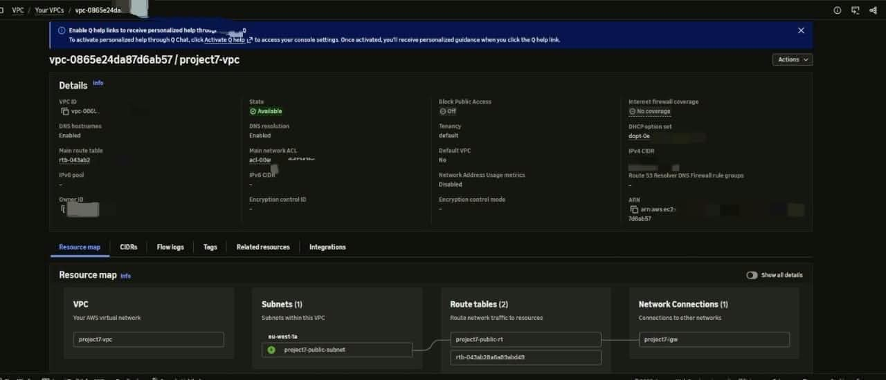
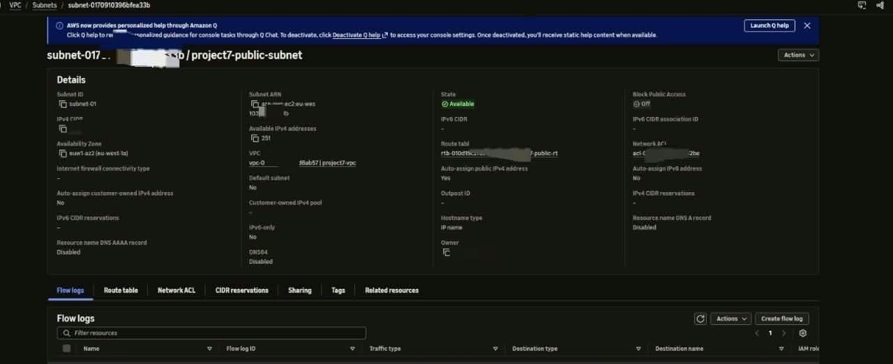
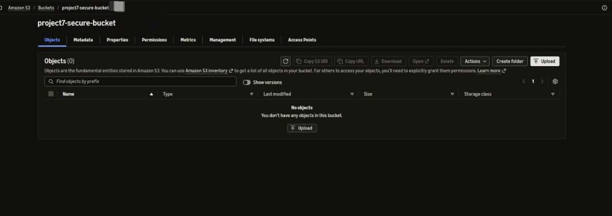
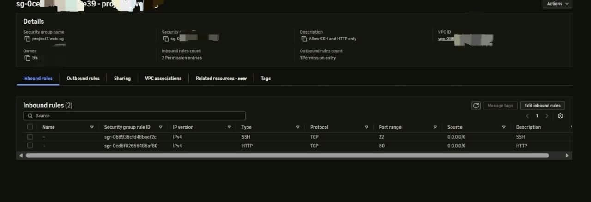
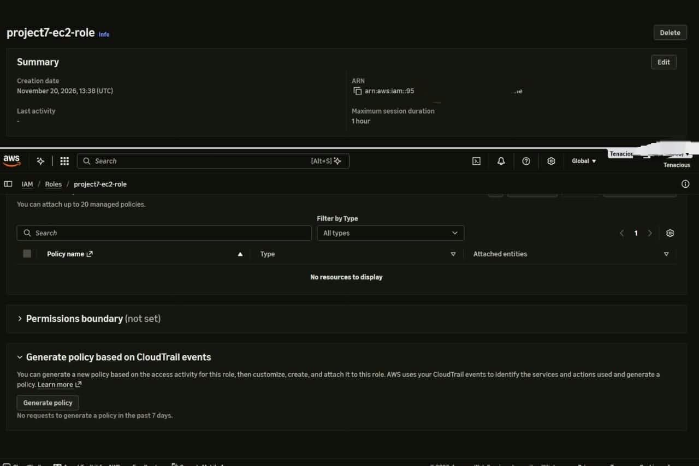

# Project 7 - Terraform AWS Infrastructure

Built secure AWS infrastructure with Terraform: VPC, public subnet, IGW, route table, security group (SSH + HTTP), encrypted S3 bucket with versioning, and IAM role for EC2. Verified in AWS Console, then destroyed with terraform destroy.

## What I Built
- VPC `10.0.0.0/16` with DNS support
- Public Subnet `10.0.1.0/24` in eu-west-1a
- Internet Gateway + Public Route Table
- Security Group - Allow SSH (22) and HTTP (80) only
- S3 Bucket - Versioning Enabled, AES256 Encryption, Public Access Blocked
- IAM Role for EC2
## Screenshots

### VPC


### Subnet


### S3 Bucket


### Security Group


### IAM Role

## How to Run
```bash
terraform init
terraform plan
terraform apply
